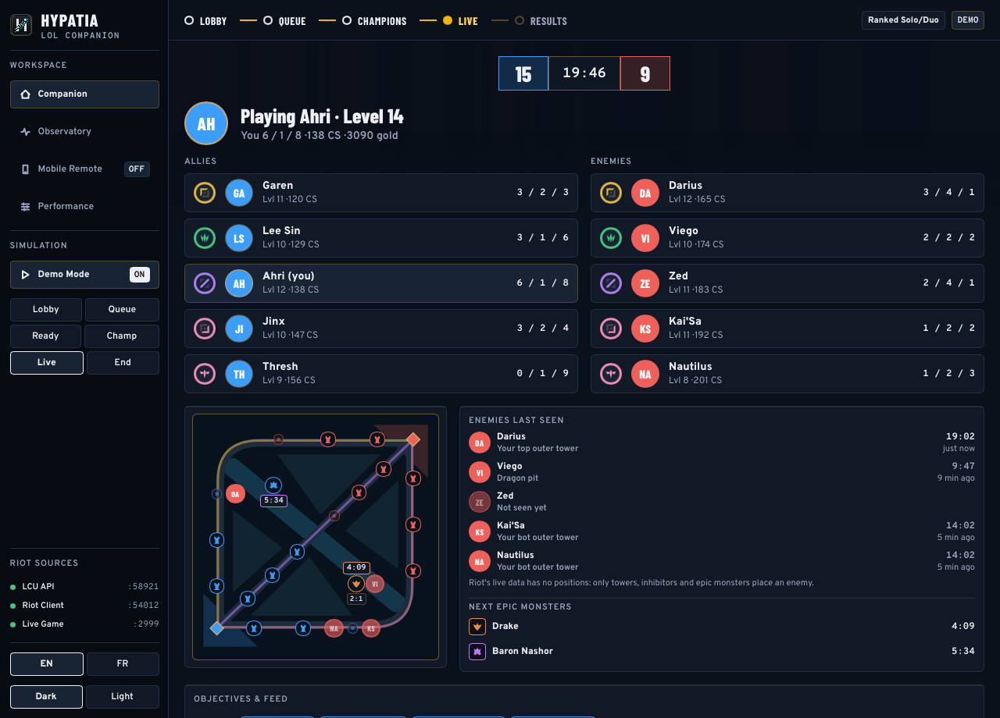
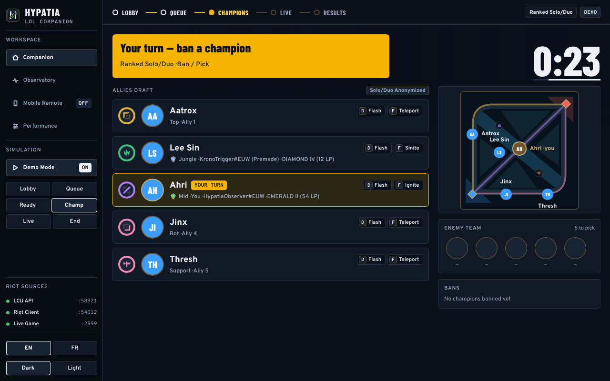
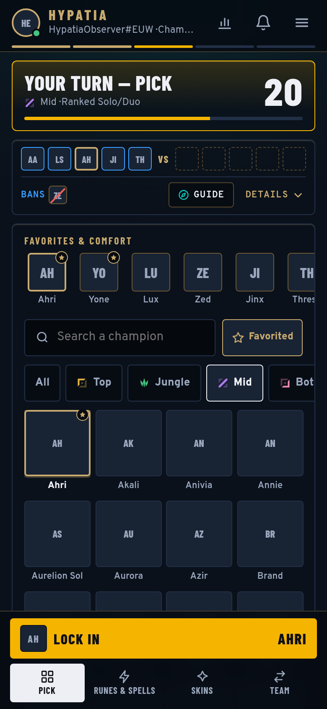
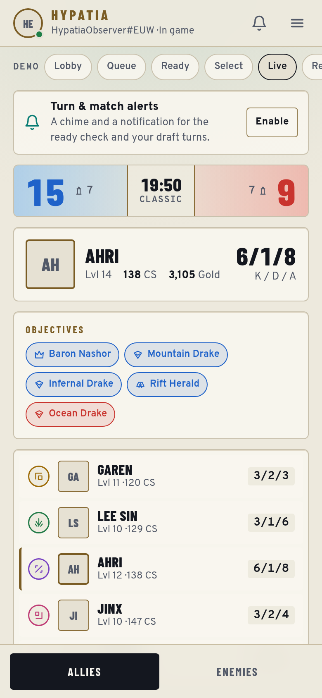
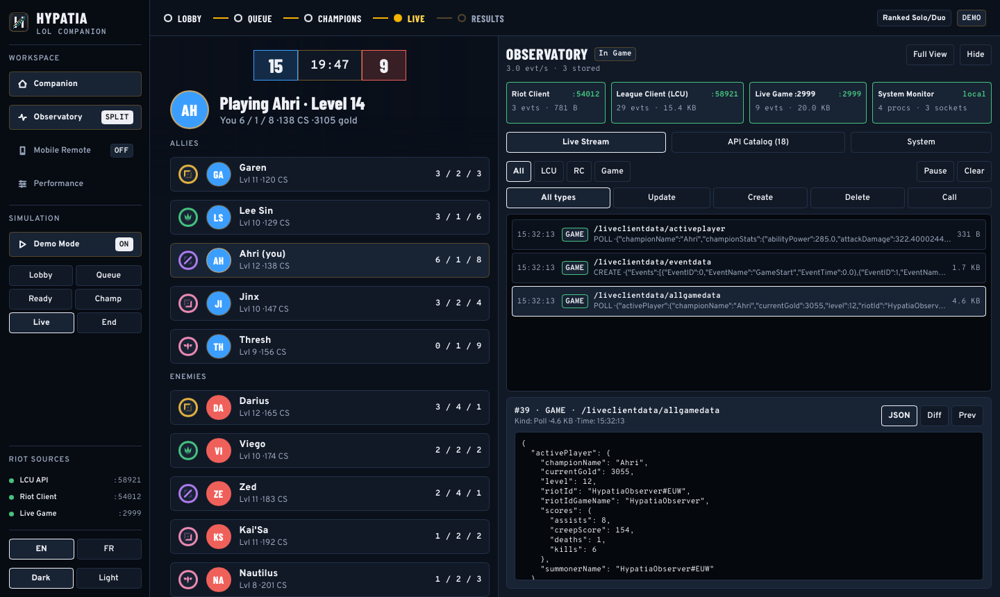

# Hypatia

> **A lightweight, 100% local League of Legends companion for Windows — follows your match from lobby to post-game, with an optional phone remote and a built-in Observatory.**

[](https://github.com/RubenVP2/hypatia/releases/latest)
[](https://github.com/RubenVP2/hypatia/actions/workflows/ci.yml)
[](LICENSE-MIT)

<p align="center">
  
</p>

---

## Download & Run

No installer, no account, no setup:

1. Download **`hypatia-windows-x86_64.zip`** from the **[Latest Release](https://github.com/RubenVP2/hypatia/releases/latest)**.
2. Unzip it anywhere and launch **`hypatia.exe`**.
3. Open League of Legends as usual — Hypatia detects the client automatically and follows your match.

---

## What It Does

- **Follows every match phase automatically**
  - **Lobby, Queue & Ready Check**: live status and timer without switching windows.
  - **Champion Select**: roles, team picks, bans, and turn timer at a glance.
  - **Live Game**: team score, towers, epic monster timers, last-seen enemy positions on Summoner's Rift, and a live event feed — designed to sit cleanly on a second monitor.
  - **Post-Game**: match outcome, your key stats, and both teams' boards.
- **Mobile Remote *(optional)***: control lobby roles, queue, Ready Check accept/decline, bans, picks, summoner spells, skins, rune pages, and swaps one-handed from your phone on the same Wi-Fi.
- **Observatory *(optional)***: open it from the left rail whenever you want to inspect the live data your local Riot & League clients expose, browse available local endpoints, or check active Riot processes.
- **Comfortable by default**: **Dark** and **Light** themes, instant **EN | FR** language switcher (auto-detected on first launch and synced with your phone), and reduced-motion support.

<p align="center">
  
</p>

---

## Safe & Private by Design

- **100% local, zero telemetry** — no account, no ads, no analytics, no external servers. Everything stays on your PC (and your local Wi-Fi if you turn on Mobile Remote).
- **Read-only by default, no game overlay** — Hypatia never injects into League of Legends and never automates actions in the background. When Mobile Remote is enabled, every action requires an explicit tap on your phone.
- **Respects Riot privacy** — Ranked Solo/Duo teammates remain hidden exactly as Riot leaves them, and local auth tokens stay masked by default.

---

## Using Mobile Remote

1. Click **Mobile Remote** in the left rail of Hypatia.
2. Scan the QR code on your PC screen with your phone camera (your phone and PC must be on the same local Wi-Fi).
3. Tap **Arm Alerts** once at the top of the phone page to enable sound chimes, vibration, notifications, and screen wake lock for queue pops and draft turns.
4. Use the one-handed bottom dock to queue, accept Ready Checks, ban/pick champions, swap spells (`D ↔ F`), skins, or rune pages, and handle role/pick/champion swaps.

You can revoke or regenerate the pairing QR code at any time in one click.

<p align="center">
  
  &nbsp;&nbsp;&nbsp;
  
</p>

---

## Light on Your PC

Hypatia only reacts when something changes in League — no constant polling, no browser engine, no FPS tax.

You can also toggle individual features under **Performance** in the left rail (saved automatically):

| Switch | Default | When off |
|---|---|---|
| Live game board | on | Does not read live match data; live view stays empty. |
| Game icons | on | Shows initials instead of loading champion/item icons. |
| Riot Client connection | on | Connects only to the League Client. |
| Mobile Remote at launch | on | Keeps the local phone server off until you start it manually. |
| Eco mode | off | When **on**: halves UI and live-game refresh rates. |
| System footprint *(Observatory)* | on | Disables Riot process CPU/RAM and socket sampling. |
| Endpoint catalog *(Observatory)* | on | Skips loading the local API endpoint list. |
| Replay API probe *(Observatory)* | off | Does not check the local Replay API. |

Closing the Observatory immediately frees its event history from memory.

---

## For Developers

Hypatia is a native **Rust 1.95+** & **Slint 1.19** workspace targeting Windows (`x86_64-pc-windows-msvc`), portable enough to build and run in `--demo` mode on Linux and macOS.

<p align="center">
  
</p>

### Architecture

```text
crates/
├── shared/    # Data models, Match Projection, LiveBoard, RemoteCommand & RemoteStateSnapshot
├── core/      # Lockfile discovery, WAMP & LiveClient connectors, event store, settings, LcuActionClient, LAN Remote server
└── desktop/   # Native Slint 1.19 desktop application
    └── src/   #   main · companion · telemetry (Observatory) · icons · labels · cli · win_dpi
bench/         # Whole-application footprint benchmark
```

### Technical Security Model

| Guarantee | Mechanism |
|---|---|
| **Read-Only Desktop Core** | The desktop companion and Observatory use `ReadOnlyRiotClient` (strictly `GET` requests and passive WAMP WebSocket subscriptions on `127.0.0.1`). |
| **Allowlisted Mobile Remote (Opt-in)** | `LcuActionClient` only accepts variants of the closed `RemoteCommand` enum — no arbitrary paths or payloads, zero background automation. |
| **128-bit QR Pairing & Host Guard** | Pairing uses a random 128-bit token (`/?token=...`) exchanged for an `HttpOnly; SameSite=Strict` session cookie, with one-click token rotation/revocation and `Host`/`Origin` validation. |
| **Ephemeral Secret Vault** | Auth tokens (`accessToken`, JWTs, lockfile passwords) are masked as `{"$secret": { id, len, hint }}` in an in-memory LRU vault until explicitly revealed in the Observatory. |
| **Zero External Network Calls** | Fonts and assets ship in the binary; all traffic stays on loopback (`127.0.0.1`) and the paired LAN. |

### Building & Running from Source

```bash
# Run with a live League of Legends client (Windows)
cargo run -p hypatia

# Run with the Observatory open alongside the companion
cargo run -p hypatia -- --telemetry

# Run in Demo mode (works on Windows, Linux, and macOS without League installed)
cargo run -p hypatia -- --demo --telemetry --remote

# Pin a specific phase in Demo mode
cargo run -p hypatia -- --demo --phase champ-select
```

On Windows, `.\build.ps1` runs the workspace test suite and produces the release binary at `target/release/hypatia.exe`.

### CLI Reference

```text
Usage: hypatia [OPTIONS]

Options:
      --demo                   Start in Demo mode with simulated event streams
      --demo-rate <DEMO_RATE>  Demo events generated per second [default: 2.0]
      --lang <LANG>            Interface language override (en or fr)
      --telemetry              Open the Observatory on launch
      --remote                 Enable Mobile Remote server and show QR pairing drawer on launch
      --no-remote              Disable automatic startup of the Mobile Remote server
      --remote-port <PORT>     Preferred LAN port for the Mobile Remote server [default: 7879]
      --light                  Start in Light (Day) theme instead of Dark (Night)
      --reduce-motion          Turn every UI animation off (the OS reduced-motion setting is honoured either way)
      --phase <PHASE>          Pin a specific phase in Demo mode (lobby, queue, ready, champ-select, live, end)
  -h, --help                   Print help
  -V, --version                Print version
```

### Benchmarks & Quality Checks

```bash
# Hot paths (ingestion, projection, catalog, discovery)
cargo run --release -p hypatia-core --example bench

# Formatting, lint, and tests
cargo fmt --all -- --check
cargo clippy --workspace --all-targets -- -D warnings
cargo test --workspace
```

```powershell
# Whole-application CPU / memory in three scenarios on Windows (close League first)
.\bench\measure.ps1
```

For domain invariants, visual design tokens, and EN/FR translation workflow, see [CONTEXT.md](CONTEXT.md), [DESIGN.md](DESIGN.md), [PRODUCT.md](PRODUCT.md), and [AGENTS.md](AGENTS.md).

---

## License & Disclaimer

Licensed under either of [MIT](LICENSE-MIT) or [Apache-2.0](LICENSE-APACHE), at your option. Bundled fonts are under the [SIL Open Font License](crates/desktop/ui/fonts/OFL.txt).

Hypatia is an independent open-source companion tool. It is **not** affiliated with, endorsed by, or sponsored by Riot Games, Inc. League of Legends and Riot Games are trademarks or registered trademarks of Riot Games, Inc.
